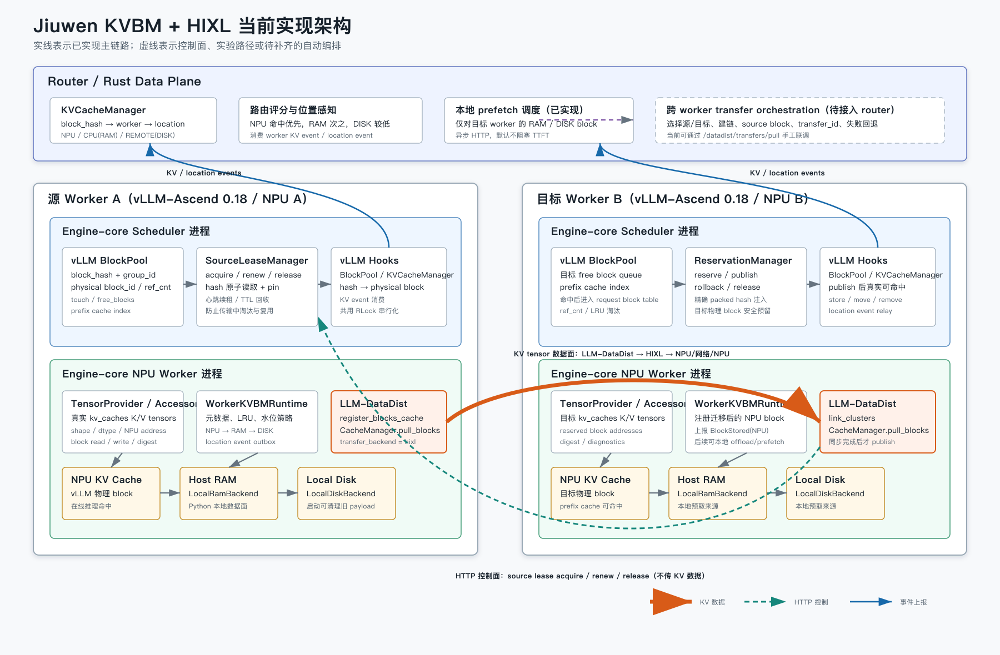

# Jiuwen KVBM 与 HIXL 数据面设计方案

## 1. 文档目标

本文描述 `agent-tools` 当前已经实现的 KVBM、vLLM-Ascend 0.18、LLM-DataDist
与 HIXL 集成方案，并明确：

- router、worker、engine-core scheduler 与 NPU worker 的职责边界；
- 本机 NPU/RAM/DISK 分层缓存的数据流；
- 跨 worker KV block 传输的控制流、HIXL 数据流和事务边界；
- 当前能力、配置方式、验证方法和后续演进路线。

本文描述的是当前代码实现，不复用 `openJiuwen-vllm-affinity` 中的代码。

## 2. 架构总览



图中最重要的边界如下：

1. **HTTP 只承载控制信息**：block ID、hash、lease、reservation、link 和操作结果。
2. **KV tensor 不经过 HTTP**：跨 worker 数据由 LLM-DataDist 调用 HIXL 搬运。
3. **BlockPool 位于 scheduler 进程**：源 block pin 和目标 block reserve/publish
   必须在 scheduler 进程完成。
4. **KV tensor 与 HIXL 位于 NPU worker 进程**：LLM-DataDist backend 内嵌在
   vLLM engine-core NPU worker 中。
5. **传输后端内嵌在 Worker 中**：真实 KV block 传输走 LLM-DataDist backend，
   不依赖额外的传输代理进程。

## 3. 设计原则

### 3.1 管理面与数据面分离

Python 管理面负责：

- block 元数据与生命周期；
- NPU/RAM/DISK location；
- LRU 和水位策略；
- source lease 与 destination reservation；
- HTTP 控制接口；
- router location event。

高性能数据面负责：

- 本机 NPU tensor 的真实读写；
- LLM-DataDist blocks cache 注册；
- HIXL 建链；
- 跨 worker NPU KV block 传输。

### 3.2 复用 vLLM 自身的 BlockPool 语义

KVBM 不维护一套独立的物理 block 分配器，而是使用 vLLM 自有接口：

- `BlockPool.touch()`：增加源 block 引用并从 free queue 移除；
- `BlockPool.free_blocks()`：释放 lease 或 reservation 引用；
- `BlockPool.get_new_blocks()`：预留目标物理 block；
- `cached_block_hash_to_block.insert()`：发布目标 prefix cache；
- `KVCacheBlock.block_hash`：保存带 KV cache group ID 的完整内部 hash。

这样可以保证 vLLM scheduler、prefix cache 和 KVBM 对物理 block 所有权的理解一致。

### 3.3 hash 与物理 block 必须原子绑定

外部 KV event 中的 hash 可能经过格式转换，不能用它反推 vLLM 内部完整 hash。
跨 worker 传输使用 scheduler BlockPool 中的 packed hash：

```text
BlockHashWithGroupId = raw block hash + 4-byte KV cache group ID
```

source lease 在同一个 BlockPool 临界区内完成：

```text
读取 block_hash -> 校验 block_id -> BlockPool.touch()
```

因此不存在读取 hash 后、pin 前 block 被复用的窗口。

### 3.4 先传输，后发布

目标 block 在 HIXL 传输成功前只处于 reservation 状态，不会进入 prefix cache。
只有满足以下条件后才执行 publish：

- LLM-DataDist `pull_blocks()` 成功；
- source lease 在 publish 前同步续租成功；
- packed hash 数量与目标 block 数量一致；
- 目标 block 仍由 reservation 独占。

## 4. 组件职责

| 组件 | 运行位置 | 当前职责 |
|---|---|---|
| Router KVCacheManager | router | 维护 `block_hash -> worker -> location` |
| Router scorer | router | 根据 NPU/RAM/DISK 命中质量参与 worker 评分 |
| Router prefetch | router | 对目标 worker 已知的 RAM/DISK block 发起异步本地预取 |
| vLLM hooks | scheduler/NPU worker | 捕获 KV event、BlockPool、KVCacheManager 和真实 tensor |
| `VllmAscend018TensorProvider` | NPU worker | 暴露 KV tensor shape、dtype、地址、block 读写和 digest |
| `KVBMManager` | NPU worker | 管理 block 元数据、location、状态、LRU 和本地后端 |
| `WorkerKVBMRuntime` | NPU worker | 执行水位、offload、prefetch，并产生 location event |
| `SourceBlockLeaseManager` | scheduler | pin/renew/release 源 block，TTL 回收遗留 lease |
| `BlockPoolReservationManager` | scheduler | reserve/publish/rollback 目标物理 block |
| `PythonLLMDataDistBackend` | NPU worker | 注册 blocks cache、link cluster、调用 `pull_blocks()` |
| CANN LLM-DataDist | NPU worker/native | 将 block 语义映射为底层传输操作 |
| HIXL | CANN native runtime | 实际执行 NPU/网络/NPU 数据传输 |

## 5. Worker 进程模型

vLLM 的多进程结构决定了 KVBM 不能只安装在外层 AsyncLLM 进程。

### 5.1 Scheduler 进程

持有：

- `KVCacheManager`；
- `BlockPool`；
- free block queue；
- prefix-cache hash index；
- request block table。

KVBM 在该进程安装 BlockPool/KVCacheManager hook，并启动仅监听
`127.0.0.1` 的内部 reservation 服务。内部端口默认为公共 KVBM 控制端口加
`10000`，也可以通过 `kvbm_reservation_port` 显式配置。

### 5.2 NPU Worker 进程

持有：

- 真实 `kv_caches` K/V tensor；
- `VllmAscend018TensorProvider`；
- `WorkerKVBMRuntime`；
- RAM/DISK backend；
- LLM-DataDist Python wrapper；
- HIXL native runtime。

该进程启动公共 KVBM HTTP 控制服务，并把 BlockPool 操作代理到 scheduler
内部服务。

## 6. 本机分层缓存

### 6.1 NPU 到 RAM

当 `cached_npu_blocks > kvbm_npu_high_watermark_blocks` 时：

1. LRU 选择冷的 `CACHED_NPU` block；
2. accessor 从真实 NPU KV tensor 读取完整 block payload；
3. `LocalRamBackend` 保存 payload；
4. 元数据 location 更新为 `HOST_RAM`；
5. 产生 `NPU -> RAM` move event。

### 6.2 RAM 到 DISK

当 RAM 字节数超过 `kvbm_ram_high_watermark_bytes` 时：

1. LRU 选择冷的 `CACHED_RAM` block；
2. 从 RAM backend 读取 payload；
3. `LocalDiskBackend` 写入 worker 独立目录；
4. 删除 RAM payload；
5. location 更新为 `DISK`；
6. 产生 `RAM -> DISK` move event。

### 6.3 RAM/DISK 预取回 NPU

router 只对已知位于 RAM/DISK 的 block 发起 prefetch：

1. router 按请求 token 计算匹配 hash；
2. 排除已经位于 NPU 的 block；
3. 生成 `request_id`、相对预算和绝对 `deadline_epoch_ms`；
4. 异步调用目标 worker `/kvbm/prefetch`；
5. worker 以 `block_hash` 为键取得 in-flight 所有权，重复请求不再搬运；
6. worker 从 RAM 或 DISK 读取 payload，最终提交前保留源副本；
7. accessor 写回目标 NPU block；
8. 再次检查 deadline、physical block 是否被复用，以及相同 hash 是否已经
   由推理请求发布；
9. 检查通过后删除 RAM/DISK 源副本并产生 `RAM/DISK -> NPU` move event；
10. 检查失败时清理刚写入的运行时 payload、恢复原 location，并报告
    `rolled_back`，不产生 NPU location event。

当前本机分层搬运是 Python accessor/backend 路径，不经过 HIXL。
Router 默认仍以 fire-and-forget 方式触发，deadline 用于限制迟到预取继续污染
缓存，并不保证当前请求等待或命中。真实 NPU 槽位释放和重新申请仍需继续把
本机 offload/prefetch 接入 Scheduler BlockPool reservation。

## 7. 跨 Worker HIXL 传输

### 7.1 初始化

每个启用 LLM-DataDist 的 worker 启动时执行：

1. 从真实 KV tensor 推导 device ID、shape、dtype 和 tensor 地址；
2. 创建 `LLMDataDist(role, cluster_id)`；
3. 使用 `transfer_backend=hixl` 初始化；
4. 调用 `register_blocks_cache()` 注册本地 KV cache；
5. 保存本地 `cache_id`；
6. 通过 `/datadist/link` 与远端 cluster 建链。

### 7.2 事务传输时序

图中的方向刻意不同：目标 Worker B 通过 HTTP 向源 Worker A 发起
lease acquire/renew/release，因此控制流是 `B -> A`；源端 KV tensor 由 HIXL
写入目标端，因此数据流是 `A -> B`。

目标 worker 收到 `/datadist/transfers/pull` 后执行：

1. 通过源 worker HTTP 控制端获取 source lease；
2. 源 scheduler 原子读取 packed hash，并执行 `BlockPool.touch()`；
3. 源端启动 lease TTL，目标端启动续租心跳；
4. 目标 scheduler 通过 `get_new_blocks()` reserve 目标 block；
5. 目标 NPU worker 调用 `LLMDataDist CacheManager.pull_blocks()`；
6. LLM-DataDist 使用 HIXL 把源 NPU KV tensor 搬到目标 NPU tensor；
7. 目标端在 publish 前同步 renew source lease；
8. 目标 scheduler 写入完整 packed hash 和 prefix-cache index；
9. reservation 引用释放为 0，block 进入可命中、可 LRU 淘汰状态；
10. 目标 worker 上报 `BlockStored(NPU)` location event；
11. 目标端停止心跳并释放 source lease。

HTTP 请求只包含：

```json
{
  "transfer_id": "request-123-prefetch-0",
  "remote_cluster_id": 0,
  "source_control_url": "http://10.0.0.1:18011",
  "source_blocks": [1, 2],
  "source_lease_ttl_ms": 30000,
  "reservation_ttl_ms": 120000
}
```

KV tensor 数据不进入 JSON，也不经过 router。

### 7.3 失败处理

| 失败点 | 当前处理 |
|---|---|
| source lease 获取失败 | 不 reserve、不传输 |
| 目标 block 不足 | 释放 source lease |
| HIXL/LLM-DataDist pull 失败 | rollback 目标 reservation，释放 source lease |
| source lease 续租失败 | 禁止 publish，rollback 目标 reservation |
| prefix-cache publish 失败 | 撤销已插入 hash，归还目标 block |
| source lease release HTTP 失败 | 源 scheduler TTL sweeper 自动释放 |
| 调用方提供的预期 hash 不一致 | 拒绝传输并释放 lease |

## 8. 控制接口

### 8.1 状态与建链

| 接口 | 说明 |
|---|---|
| `POST /datadist/status` | LLM-DataDist mode、cache ID、HIXL backend、linked cluster |
| `POST /datadist/link` | 建立远端 cluster 连接 |
| `POST /datadist/unlink` | 断开远端 cluster |
| `POST /datadist/digest` | 调试用 block SHA-256，不应进入热路径 |

### 8.2 源 block lease

| 接口 | 说明 |
|---|---|
| `POST /datadist/source-leases/status` | lease 状态与最近过期时间 |
| `POST /datadist/source-leases/acquire` | 原子读取 hash 并 pin block |
| `POST /datadist/source-leases/renew` | 延长 lease |
| `POST /datadist/source-leases/release` | 幂等释放引用 |

### 8.3 目标 reservation

| 接口 | 说明 |
|---|---|
| `POST /datadist/reservations/status` | BlockPool 与 reservation 统计 |
| `POST /datadist/reservations/reserve` | 从 free queue 预留目标 block |
| `POST /datadist/reservations/renew` | 活跃传输续租目标 block，防止 TTL 误回收 |
| `POST /datadist/reservations/publish` | 发布 packed hash 到 prefix cache |
| `POST /datadist/reservations/rollback` | 失败时归还目标 block |
| `POST /datadist/reservations/commit` | 保留的低层诊断接口，不注入 prefix cache |
| `POST /datadist/reservations/release` | 释放低层 commit 持有的 block |

### 8.4 传输

| 接口 | 说明 |
|---|---|
| `POST /datadist/pull` | 低层手工指定源/目标 block，主要用于诊断 |
| `POST /datadist/transfers/pull` | source lease + reserve + HIXL pull + publish 完整事务 |
| `POST /datadist/transfers/status` | 查询单个 `transfer_id` 或事务并发统计 |
| `POST /datadist/transfers/cancel` | publish 前协作式取消并触发目标回滚 |
| `POST /datadist/blocks/metadata` | 调试用精确 packed hash 查询 |

## 9. 关键配置

### 9.1 通用 Worker 配置

```yaml
kvbm_worker_enabled: true
# 默认 auto；根据已安装的 vllm-ascend 和 vllm 版本选择已注册适配器。
kvbm_worker_provider: auto
enable_prefix_caching: true
# 所有 worker 必须一致；sha256 可保证不同进程对相同前缀生成相同 hash。
prefix_caching_hash_algo: sha256
# vLLM 使用该值初始化首个 block 的 parent hash，所有 worker 必须一致。
prefix_caching_hash_seed: 0

kvbm_worker_disk_root: /tmp/jiuwen-kvbm-worker-0
kvbm_clean_disk_on_start: true
kvbm_npu_high_watermark_blocks: 0
kvbm_ram_high_watermark_bytes: 0

kvbm_prefetch_host: 127.0.0.1
kvbm_prefetch_port: 18011
kvbm_reservation_port: 28011
kvbm_transfer_max_inflight: 1
kvbm_transfer_retention_seconds: 300
```

多 worker 部署时，每个 worker 应使用不同的：

- `kvbm_worker_disk_root`；
- `kvbm_prefetch_port`；
- `kvbm_reservation_port`；
- LLM-DataDist cluster ID 和监听端口。

### 9.2 LLM-DataDist/HIXL 配置

```yaml
kvbm_data_backend: llm_datadist
kvbm_llm_datadist_mode: python
kvbm_llm_datadist_role: mix
kvbm_llm_datadist_cluster_id: 0
kvbm_llm_datadist_listen_ip: 10.0.0.1
kvbm_llm_datadist_listen_port: 19000
kvbm_llm_datadist_transfer_backend: hixl
kvbm_llm_datadist_enable_cache_manager: true
```

`cluster_id` 是 LLM-DataDist 逻辑 ID，不要求等于物理 NPU device ID，但同一通信域内必须唯一。
真实 device ID 从 KV tensor 所在 NPU 推导。

跨容器或跨节点 source lease 需要目标 worker 能访问源 KVBM 控制端口：

```yaml
kvbm_prefetch_host: 0.0.0.0
```

该端口应只暴露在可信集群网络。

## 10. Router 当前集成

router 当前已经实现：

- 消费 worker KV event 和 KVBM location event；
- 维护 block location；
- 区分 NPU、RAM 和 DISK 命中质量；
- 只对 RAM/DISK 命中发起本地 prefetch；
- 支持 fire-and-forget，避免把 prefetch 等待计入 TTFT。

router 当前尚未自动执行跨 worker HIXL 迁移。真实 HIXL + vLLM 命中可以先通过
worker 控制接口手工验证；自动化还需要 router 增加 transfer orchestration：

```text
请求 hash
  -> 找到源 worker 和物理 block
  -> 选择目标 worker
  -> 确认 link
  -> /datadist/transfers/pull
  -> 成功后把请求发给目标 worker
  -> 失败时回退源 worker或正常重算
```

## 11. 传输实现边界

当前实现仅包含 Worker 内嵌的 LLM-DataDist 传输后端，以 KV cache/block、layer
和 cache key 为传输语义，由 CANN 的 HIXL runtime 执行底层数据搬运。
不提供独立传输代理进程、UDS/JSON-RPC 客户端或 raw HIXL 实验后端。

## 12. 代码映射

| 能力 | 主要文件 |
|---|---|
| KVBM 元数据与分层状态 | `packages/jiuwen-kvbm/src/jiuwen_kvbm/manager.py` |
| Worker runtime 与水位 | `packages/jiuwen-kvbm/src/jiuwen_kvbm/runtime/worker_runtime.py` |
| 目标 reservation/publish | `packages/jiuwen-kvbm/src/jiuwen_kvbm/runtime/block_reservation.py` |
| 源 block lease | `packages/jiuwen-kvbm/src/jiuwen_kvbm/runtime/block_lease.py` |
| vLLM-Ascend hooks 与控制 API | `packages/jiuwen-kvbm/src/jiuwen_kvbm/integrations/vllm_ascend_018.py` |
| LLM-DataDist backend | `packages/jiuwen-kvbm/src/jiuwen_kvbm/transfer/llm_datadist.py` |
| Router location prefetch | `packages/infer_router/src/openjiuwentools/infer_router/data_plane/server.py` |
| Worker prefetch client | `packages/infer_router/src/openjiuwentools/infer_router/worker/worker_manager.py` |

## 13. 当前完成度与边界

### 13.1 已完成

- vLLM-Ascend 0.18 KV tensor 发现与诊断；
- KV event 到真实物理 block ID 映射；
- NPU/RAM/DISK 元数据与真实 payload 搬运；
- 水位触发与 location event；
- router location 感知与本地异步 prefetch；
- LLM-DataDist 初始化、cache 注册、link/unlink；
- HIXL block pull；
- 目标 BlockPool reserve、rollback 和 prefix-cache publish；
- source lease、续租、TTL 回收；
- 目标 reservation TTL 自动回收；
- `transfer_id` 幂等、状态查询和协作式取消；
- HTTP 超时后的终态结果查询；
- 迁移成功后的 NPU location 发布；
- 请求级 prefetch deadline、按 hash in-flight 去重和迟到回滚；
- BlockPool publish 前的完整 packed hash 重复检查。

### 13.2 尚未完成

- router 自动选择源/目标并触发跨 worker 迁移；
- 控制接口认证、限流和审计；
- 多模型、多 LoRA、多 KV cache group 的完整矩阵验证；
- 真实 NPU 环境下的最终 prefix-cache hit 与输出一致性验收；
- 长期进程内 Rust/C++ native extension。

## 14. 推荐验证步骤

### 14.1 状态检查

目标 worker：

```bash
curl -sS -X POST http://127.0.0.1:18020/datadist/status -d '{}'
```

应确认：

```json
{
  "health": {
    "mode": "python",
    "initialized": true,
    "transfer_backend": "hixl"
  }
}
```

### 14.2 建链

两个 worker cache 注册完成后调用 `/datadist/link`，并确认
`linked_cluster_ids` 包含远端 cluster ID。

### 14.3 生成源缓存

直接向源 worker 发送请求，记录其 KV event 对应的物理 `block_ids`。

### 14.4 事务迁移

直接调用目标 worker：

```bash
curl -sS -X POST http://127.0.0.1:18020/datadist/transfers/pull \
  -H 'Content-Type: application/json' \
  -d '{
    "transfer_id": "request-123-prefetch-0",
    "remote_cluster_id": 0,
    "source_control_url": "http://10.0.0.1:18011",
    "source_blocks": [1, 2],
    "source_lease_ttl_ms": 30000,
    "reservation_ttl_ms": 120000
  }'
```

成功结果应包含：

- `ok: true`；
- `published_count` 与源 block 数一致；
- `source_lease.release.ok: true`；
- 目标 reservation 状态为 `published`。

### 14.5 数据一致性

调试阶段可以分别调用源端和目标端 `/datadist/digest`，确认 block SHA-256 一致。

### 14.6 vLLM 命中

将完全相同的 prompt 直接发送到目标 worker，确认：

- prefix-cache hit block 数大于 0；
- 输出与未迁移场景一致；
- TTFT 相比重算明显下降；
- source lease 已释放；
- 目标 block 可被后续请求命中。

## 15. 演进路线

### 阶段 A：补齐 Worker 可靠性

1. 增加异步传输队列和更细粒度并发指标；
2. 对不可中断的 HIXL 调用增加底层异步 cancel 能力；
3. 增加跨进程重启后的事务恢复；
4. 增加端到端故障注入测试。

### 阶段 B：Router 自动编排

1. worker 上报可达的 KVBM control URL、cluster ID 和 HIXL endpoint；
2. router 维护 `block_hash -> source physical block`；
3. 调度器比较远端迁移成本与本地重算成本；
4. 异步或有界等待 transfer；
5. 失败回退到源 worker或重算。

### 阶段 C：高性能 Native 化

1. 保留 Python 管理面和稳定协议；
2. 把热路径迁移到进程内 Rust/C++ extension；
3. 基于现有 LLM-DataDist 后端和 CANN 接口评估 native 数据面集成；
4. 减少 Python 对 tensor 数据路径的参与；
5. 支持批量、异步、零拷贝和更细粒度 telemetry。
